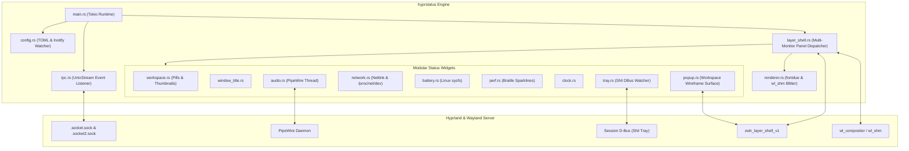

# hyprstatus ⚡

A blazing-fast, zero-bloat, i3-style status bar daemon designed specifically for [Hyprland](https://hyprland.org) in pure Rust.


---

## Features

- **Blazing Fast & Zero Bloat**: Pure Rust software renderer directly rasterizing pixels into `wl_shm` shared memory with zero intermediate rendering engines or WebKit bloat.
- **WLR Layer Shell Native**: Uses the `zwlr_layer_shell_v1` protocol to anchor exclusive top/bottom panels with precise multi-monitor layout management.
- **Dynamic Multi-Monitor & Hot-Plugging**: Automatically tracks `wl_output` additions and removals, maintaining independent rendering loops and per-output configuration overrides (e.g. `[output.HDMI-A-1]`).
- **Interactive Workspace Thumbnails**: Hovering over workspace pills reveals miniature floating wireframe application previews; clicking any preview thumbnail immediately dispatches focus to that window via Hyprland IPC.
- **Real-Time PipeWire Audio**: Built-in native PipeWire client thread monitoring default sink/source node states, volume levels, mute toggles, and microphone activity. Supports scroll-wheel volume adjustments and click-to-mute.
- **Netlink Network & Wi-Fi Monitor**: Asynchronous netlink interface monitoring and real-time delta throughput calculations from `/proc/net/dev`. Displays dynamic signal strength icons (`󰤨`, `󰤥`, `󰤢`, `󰤟`, `󰤮`), active SSID, and connection type (Ethernet `󰈀` vs Wi-Fi). Click to launch `nmtui`.
- **Sysfs Battery & Power Management**: Direct sysfs metrics parsing (`/sys/class/power_supply/BAT*/*` and `AC`) for charging status, percentage, wattage, and time estimates, with automated desktop notifications below 15%.
- **Braille Performance Sparklines**: Samples `/proc/stat` and `/proc/meminfo` into rolling ring buffers, rasterizing smooth inline Unicode Braille performance graphs (e.g., `⣀⣤⣾⣿`) for CPU utilization and RAM usage without external processes.
- **StatusNotifierItem (SNI) System Tray**: Implements the FreeDesktop `org.kde.StatusNotifierWatcher` and `org.kde.StatusNotifierItem` DBus interfaces via `zbus`, allowing background applications (Nextcloud, Discord, Steam, etc.) to register clickable tray icons with custom pixmaps.
- **TOML Config & Instant Hot-Reloading**: Strongly-typed TOML configuration at `~/.config/hyprstatus/config.toml` automatically generated on first launch. Actively watched with `notify` for instantaneous, zero-restart style and layout hot-reloads.

---

## Architecture Overview



---

## Configuration (`~/.config/hyprstatus/config.toml`)

`hyprstatus` automatically generates a default configuration file if one does not exist:

```toml
[bar]
height = 30
position = "top"
font_name = "JetBrainsMono Nerd Font"
font_path = "/usr/share/fonts/TTF/JetBrainsMonoNerdFontPropo-Bold.ttf"
font_size = 13.0
spacing = 6
padding_horizontal = 10
padding_vertical = 3
margin_top = 0
margin_bottom = 0
margin_left = 0
margin_right = 0
separator = " | "

[colors]
background = "#1e1e2e"
foreground = "#cdd6f4"
block_background = "#313244"
border = "#45475a"
active_workspace_bg = "#89b4fa"
active_workspace_fg = "#11111b"
inactive_workspace_bg = "#313244"
inactive_workspace_fg = "#a6adc8"
urgent_workspace_bg = "#f38ba8"
urgent_workspace_fg = "#11111b"
separator = "#585b70"
cpu = "#f9e2af"
memory = "#a6e3a1"
audio = "#cba6f7"
network = "#74c7ec"
battery_good = "#a6e3a1"
battery_warning = "#fab387"
battery_critical = "#f38ba8"

[layout]
left = ["workspaces", "window_title"]
center = ["perf"]
right = ["tray", "network", "audio", "battery", "clock"]

[modules.audio]
step_percent = 5
show_mic = true

[modules.network]
format = "{icon} {ssid} {speed}"
click_command = "alacritty -e nmtui"

[modules.battery]
format = "{icon} {percentage}%"
low_threshold = 15
notify_on_low = true

[modules.perf]
update_interval_ms = 1000
sparkline_length = 8
click_command = "btop"

[modules.popup]
width = 260
height = 160
enabled = true

# Optional Per-Monitor Overrides:
[output.HDMI-A-1]
enabled = true
height = 32
left = ["workspaces", "window_title"]
right = ["tray", "network", "audio", "battery", "clock"]
```

---

## Interactivity & Bindings

| Target | Event | Action |
|---|---|---|
| **Workspace Pill** | Left Click | Switches active workspace directly |
| **Workspace Pill** | Hover | Opens live interactive window preview popup |
| **Workspace Popup** | Left Click on thumbnail | Dispatches focus directly to the target window |
| **Audio Block** | Left Click | Toggles master speaker mute |
| **Audio Block** | Right Click | Toggles microphone mute |
| **Audio Block** | Scroll Wheel Up / Down | Adjusts volume by ±5% |
| **Network Block** | Left Click | Launches `nmtui` in terminal |
| **Perf Block** | Left Click | Launches `btop` / `htop` system monitor |
| **Tray Icon** | Left Click | Forwards `Activate` DBus method to application |
| **Tray Icon** | Right Click | Forwards `ContextMenu` DBus method to application |

---

## Building and Running

### Prerequisites
- Rust 1.80+
- `libpipewire-0.3` & `wayland-client` dev headers
- Nerd Font (e.g. JetBrains Mono Nerd Font)

### Build Release Binary
```bash
cargo build --release
```

### Run Status Bar
```bash
./target/release/hyprstatus
```

### Hyprland Auto-start (`hyprland.conf`)
Add the following line to `~/.config/hypr/hyprland.conf`:
```ini
exec-once = /path/to/hyprstatus
```

---

## License
MIT
