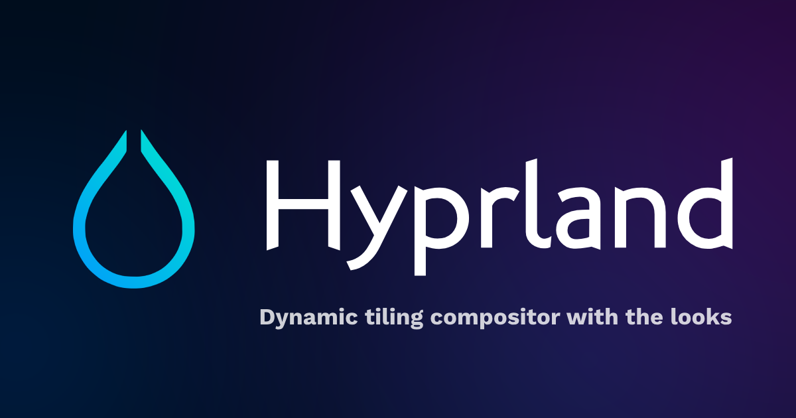
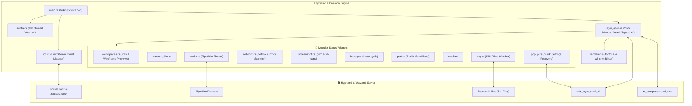

<div align="center">

# hyprstatus ⚡

### Ultra-Fast, Zero-Bloat, Native Status Bar for Hyprland

[](https://crates.io/crates/hyprstatus)
[](https://www.rust-lang.org/)
[](https://wayland.freedesktop.org/)
[](https://hyprland.org)
[](https://pipewire.org)
[](LICENSE)

<br/>



<br/>

*An unapologetically lightweight, i3bar-inspired status bar engineered in pure Rust. Rasterizes pixels directly into Wayland shared memory (`wl_shm`) with zero intermediate toolkit bloat. No GTK, no Qt, no WebKit, no Electron—just sub-millisecond frame renders and slick interactive Quick Settings popovers.*

<br/>

[**Key Features**](#-key-features) • [**Quick Settings Popovers**](#-interactive-quick-settings-popovers) • [**Architecture**](#-architecture-overview) • [**Configuration**](#-configuration) • [**Hyprland Integration**](#-hyprland-integration) • [**Installation**](#-installation--setup)

---

</div>

## ✨ Key Features

<table>
  <tr>
    <td width="50%">
      <h3>🚀 Blazing Fast & Zero Bloat</h3>
      Pure Rust software rasterizer built on <code>fontdue</code> blitting directly to <code>wl_shm</code> shared memory. Idle memory usage is ~15-20 MB, CPU usage is near 0%, and frame draws finish in fractions of a millisecond.
    </td>
    <td width="50%">
      <h3>🪟 Interactive Window Wireframes</h3>
      Hovering over workspace pills reveals floating wireframe layout previews showing relative window positions and application glyphs (󰊯 Chrome, 󰞷 Kitty, 󰈹 Firefox, 󰨞 Code). Click any wireframe to focus that window instantly!
    </td>
  </tr>
  <tr>
    <td width="50%">
      <h3>🔊 Native PipeWire Sound Popover</h3>
      Dedicated background PipeWire thread monitoring default sink/source nodes in real time. Clicking the audio block opens a sleek Quick Settings menu with an interactive volume slider, ±5% step buttons, presets (25%, 50%, 75%, 100%), and mic mute.
    </td>
    <td width="50%">
      <h3>📶 Live Wi-Fi Popover & Auth</h3>
      Real-time Wi-Fi management widget featuring radio toggle, dynamic signal waves, auto-rescanning, 1-click connect/disconnect, and an integrated in-popover password prompt with live masking, cursor animation, and error feedback.
    </td>
  </tr>
  <tr>
    <td width="50%">
      <h3>📸 One-Click Full-Screen Screenshot</h3>
      Dedicated status bar camera button (<code></code>) that captures the entire desktop canvas—<b>including the status bar and open popovers</b>—using <code>grim</code>, copies to Wayland clipboard (<code>wl-copy</code>), and notifies with thumbnail previews.
    </td>
    <td width="50%">
      <h3>📈 Braille Performance Sparklines</h3>
      Samples <code>/proc/stat</code> and <code>/proc/meminfo</code> into rolling ring buffers, rasterizing smooth inline Unicode Braille graphs (e.g. <code>⣀⣤⣾⣿</code>) for CPU utilization and RAM usage without external tools.
    </td>
  </tr>
  <tr>
    <td width="50%">
      <h3>🖥️ Dynamic Multi-Monitor Hot-Plugging</h3>
      Full <code>zwlr_layer_shell_v1</code> support. Listens for Wayland output additions/removals and renders independent per-monitor bars with customized layouts (e.g., primary vs. secondary displays).
    </td>
    <td width="50%">
      <h3>⚡ Instant TOML Hot-Reloading</h3>
      Strongly-typed configuration at <code>~/.config/hyprstatus/config.toml</code> actively watched by an inotify background worker. Modifying colors, fonts, or widget orders updates instantly without restarting the daemon.
    </td>
  </tr>
</table>

---

## 🎛️ Interactive Quick Settings Popovers

hyprstatus replaces clunky terminal launchers and heavyweight modals with bespoke **Quick Settings popovers** that match the status bar's Catppuccin Mocha aesthetic:

### 1. 🔊 Sound & Audio Quick Settings
* **Interactive Volume Slider**: Click or drag anywhere along the track to set volume from 0% to 100%.
* **Fine Step Adjustments**: Dedicated `-5%` and `+5%` buttons for incremental control.
* **Instant Presets**: Quick buttons for `25%`, `50%`, `75%`, and `100%`.
* **Mute Toggles**: Toggle master audio output or toggle microphone input with live status indicators.
* **Animated Audio Waves**: Visual pulsing equalizer bars reflecting audio activity.

### 2. 📶 Wi-Fi & Network Quick Settings
* **Wi-Fi Radio Toggle**: Turn Wi-Fi radio ON or OFF with a single click.
* **Real-Time Network Discovery**: Dynamic periodic scanning reflects newly appeared or turned-off hotspots in real time without stale ghost entries.
* **Signal Strength Indicators**: Dynamic wave glyphs (`󰤨`, `󰤥`, `󰤢`, `󰤟`, `󰤮`) indicating exact reception.
* **In-Popover Password Authentication**: Secure networks prompt for credentials directly inside the Wi-Fi popover with full keyboard support, password visibility toggle, and instant error feedback—no external modal windows needed.
* **Terminal Fallback**: Click "Network Manager Settings" or right-click the bar module to launch `nmtui` in your favorite terminal (`kitty`, `alacritty`, `foot`, etc.).

### 3. 🪟 Workspace Layout Wireframes
* **Geometric Layout Miniatures**: Displays a visual bounding wireframe representing window geometry on each workspace.
* **Application Icons**: Detects classes and embeds Nerd Font glyphs (`󰊯` Chrome, `󰞷` Terminal, `󰈹` Firefox, `󰨞` Editor, `󰘑` Files).
* **Direct Window Focus**: Clicking any window thumbnail dispatches focus directly to that client via Hyprland IPC (Lua dispatch `hl.dsp.focus` or legacy).

### 4. 📸 Instant Screenshot Button
* **Full-Screen Capture (Includes Status Bar)**: Captures the entire composited screen using `grim`, including layer-shell surfaces and open popovers.
* **Visual Flash Feedback**: The camera button flashes bright `#f9e2af` upon click.
* **Dual Action**: Left-click captures the entire desktop across all monitors; Right-click captures only the clicked monitor.
* **Automatic Clipboard & Notifications**: Immediately puts the image into your clipboard (`wl-copy`) and shows a desktop notification preview with dunst/mako/swaync.

---

## 🏗️ Architecture Overview

hyprstatus is engineered as an asynchronous, modular daemon powered by **Tokio**, communicating directly with the Wayland compositor and Linux kernel subsystems:



---

## 🖱️ Interactive Controls & Bindings

| Target | Event | Action |
|---|---|---|
| **Workspace Pill** | Left Click | Switch to selected workspace |
| **Workspace Pill** | Scroll Wheel Up / Down | Cycle to previous / next workspace |
| **Workspace Pill** | Pointer Hover | Open live window layout wireframe preview |
| **Workspace Popup** | Left Click on thumbnail | Dispatch focus directly to clicked window |
| **Screenshot Button** | Left Click | Capture full desktop (all monitors + status bar + popovers) |
| **Screenshot Button** | Right Click | Capture current monitor only |
| **Audio Block** | Left Click | Open native Sound & Volume Quick Settings popover |
| **Audio Block** | Right Click | Toggle microphone input mute |
| **Audio Block** | Scroll Wheel Up / Down | Quick volume adjustment by ±5% |
| **Sound Popover** | Click / Drag Slider | Set master volume directly to percentage |
| **Sound Popover** | Preset / Step Buttons | Set volume presets (`25%`–`100%`) or adjust ±5% |
| **Sound Popover** | Mic Mute Button | Toggle microphone mute |
| **Network Block** | Left Click | Open native Wi-Fi Quick Settings popover |
| **Network Block** | Right Click | Launch `nmtui` in terminal |
| **Wi-Fi Popover** | Network Row Click | Connect to network (prompts for password directly in popover if needed) |
| **Wi-Fi Popover** | Radio / Rescan Buttons | Toggle Wi-Fi radio ON/OFF or trigger fresh scan |
| **Performance Block**| Left Click | Launch `btop` / `htop` system monitor |
| **Tray Icon** | Left Click | Forward `Activate` DBus call to application |
| **Tray Icon** | Right Click | Forward `ContextMenu` DBus call to application |
| **Backdrop / Screen**| Click Anywhere | Dismiss any open popover menu |

---

## ⚙️ Configuration

`hyprstatus` automatically generates a default Catppuccin Mocha configuration file on first launch at `~/.config/hyprstatus/config.toml`.

```toml
# hyprstatus - Blazing-fast i3-style Status Bar for Hyprland
# Config location: ~/.config/hyprstatus/config.toml

[bar]
height = 30
position = "bottom"                         # "top" or "bottom"
font_name = "JetBrainsMono Nerd Font"
font_path = "/usr/share/fonts/TTF/JetBrainsMonoNerdFontPropo-Bold.ttf"
font_size = 12.0
spacing = 6
padding_horizontal = 10
padding_vertical = 3
margin_top = 0
margin_bottom = 0
margin_left = 0
margin_right = 0
separator = " | "

[colors]
background = "#1e1e2e"                     # Catppuccin Mocha Base
foreground = "#cdd6f4"                     # Text
block_background = "#313244"               # Surface0
border = "#45475a"                         # Surface1
active_workspace_bg = "#89b4fa"            # Blue
active_workspace_fg = "#11111b"            # Crust
inactive_workspace_bg = "#313244"          # Surface0
inactive_workspace_fg = "#a6adc8"          # Subtext0
urgent_workspace_bg = "#f38ba8"            # Red
urgent_workspace_fg = "#11111b"
separator = "#585b70"
cpu = "#f9e2af"                            # Yellow
memory = "#a6e3a1"                         # Green
audio = "#cba6f7"                          # Mauve
network = "#74c7ec"                        # Sapphire
battery_good = "#a6e3a1"
battery_warning = "#fab387"                # Peach
battery_critical = "#f38ba8"
screenshot = "#fab387"                     # Peach

[layout]
left = ["workspaces", "window_title"]
center = ["perf"]
right = ["tray", "screenshot", "network", "audio", "battery", "clock"]

[modules.screenshot]
icon = ""
label = ""                                 # Optional label beside icon
save_directory = "~/Pictures/Screenshots"   # Where screenshots are saved
copy_to_clipboard = true                   # Copy image to clipboard via wl-copy
notify = true                              # Send notification via notify-send
all_monitors = true                        # Left-click captures all monitors

[modules.audio]
step_percent = 5
show_mic = true

[modules.network]
format = "{icon} {ssid} {speed}"
click_command = "hyprstatus --wifi-menu"

[modules.battery]
format = "{icon} {percentage}%"
low_threshold = 15
notify_on_low = true

[modules.perf]
update_interval_ms = 1000
sparkline_length = 8
click_command = "btop"

[modules.clock]
format = "%a %b %d  %H:%M:%S"
interval_sec = 1

[modules.popup]
width = 260
height = 160
enabled = true

# Optional Per-Monitor Overrides:
[output.HDMI-A-1]
enabled = true
height = 32
left = ["workspaces", "window_title"]
right = ["tray", "screenshot", "network", "audio", "battery", "clock"]
```

---

## 🚀 Hyprland Integration

### Modern Hyprland with Lua (`hyprland.lua`)
Add the following line to your `~/.config/hypr/hyprland.lua`:
```lua
hl.exec_cmd("/path/to/hyprstatus")
```

### Classic Hyprland (`hyprland.conf`)
Add the following line to your `~/.config/hypr/hyprland.conf`:
```ini
exec-once = /path/to/hyprstatus
```

---

## 📦 Installation & Setup

### 1. Prerequisites
Ensure you have the required development libraries and Wayland tools installed on your system:

#### Arch Linux / EndeavourOS:
```bash
sudo pacman -S rust cargo clang pipewire grim slurp wl-clipboard wofi notify-send ttf-jetbrains-mono-nerd
```

#### Fedora:
```bash
sudo dnf install rust cargo clang pipewire-devel wayland-devel grim slurp wl-clipboard wofi libnotify jetbrains-mono-fonts-all
```

#### Ubuntu / Debian:
```bash
sudo apt install rustc cargo clang libclang-dev libpipewire-0.3-dev libwayland-dev grim slurp wl-clipboard wofi libnotify-bin fonts-jetbrains-mono
```

### 2. Install

#### From crates.io:
```bash
cargo install hyprstatus
```

#### From Source:
```bash
# Clone the repository
git clone https://github.com/hvsrathore/hyprstatus.git
cd hyprstatus

# Build optimized release binary
cargo build --release

# Optional: Install to user local bin
cp ./target/release/hyprstatus ~/.local/bin/
```

### 3. Launch
```bash
hyprstatus
```

---

## 📄 License

This project is licensed under the [MIT License](LICENSE).
Feel free to fork, enhance, and customize to your heart's content!
